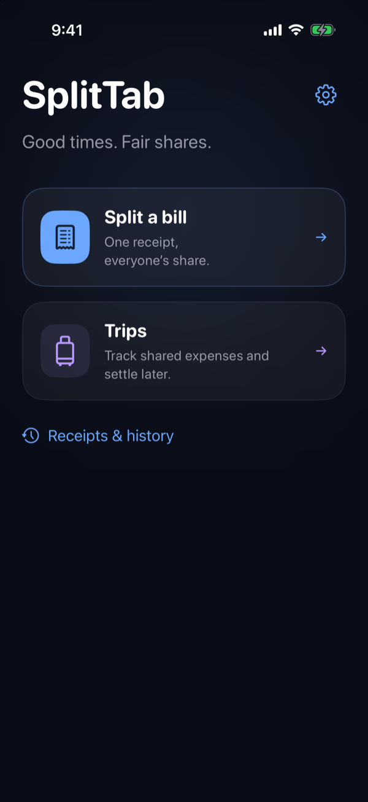
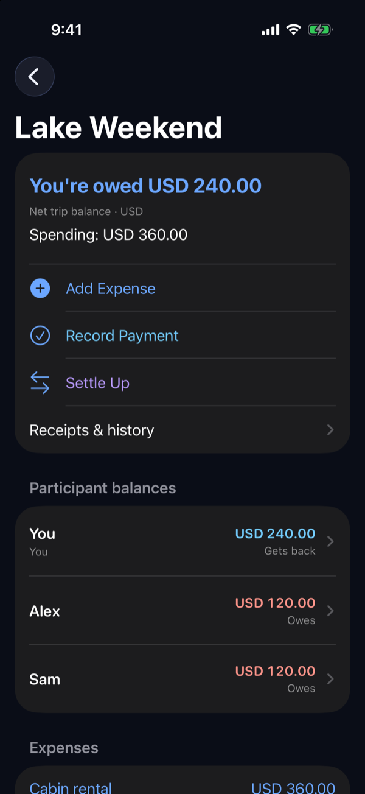
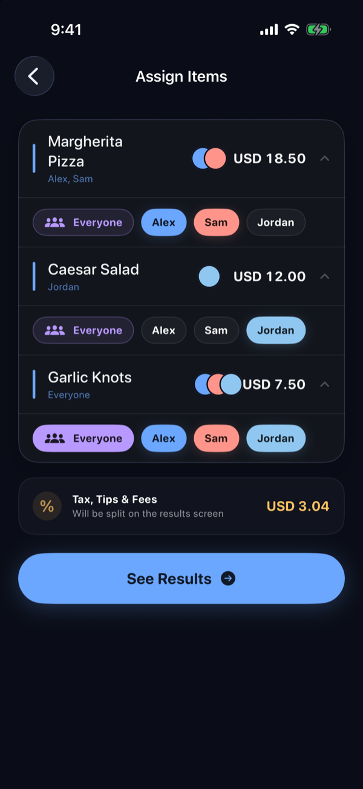
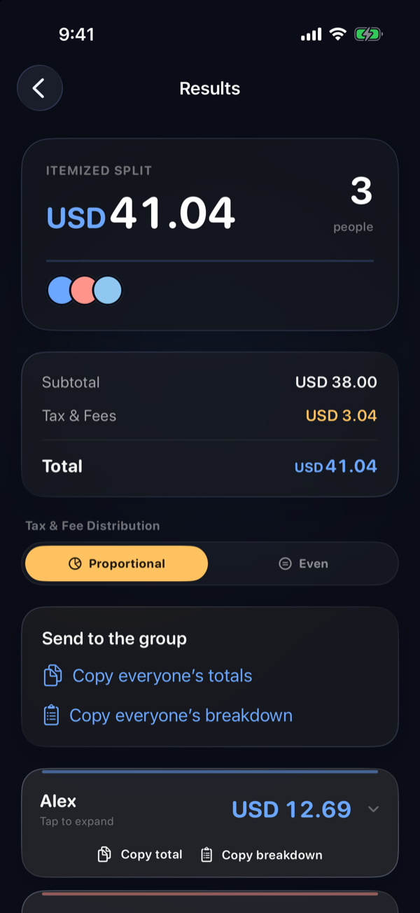

# SplitTab

A SwiftUI iOS app for managing trip expenses and splitting standalone bills. Scan a receipt into editable line
items or enter items manually, assign purchases to participants, and reconcile
each person's share with the bill total.

<p align="center">
  
  
  
  
</p>
<p align="center"><sub>Screenshots show a sample trip and bill with made-up names, entered manually in the Simulator.</sub></p>

## Features

- Camera capture and optional AI receipt extraction with manual corrections.
- Itemized and equal splits, including items shared by multiple people.
- Taxes, tips, fees, and discounts allocated across participants.
- Decimal currency calculations and rounding-remainder reconciliation.

## Build and run

Requires macOS, Xcode 26.4 or newer, and an iOS 26 SDK. The project targets iOS 26.
There are no third-party package dependencies.

```sh
git clone https://github.com/ppratick/SplitTab.git
cd SplitTab
open SplitTab.xcodeproj
```

Select the **SplitTab** scheme and an iPhone simulator, then run. For a build on your own iPhone, configure your own Personal Team and a unique bundle identifier using the local signing file below. Free Personal Team provisioning expires after seven days, so device builds need periodic reinstalling from Xcode. This repository provides source code; no iPhone installer is included. Manual receipt
entry and bill splitting work without an API key. For an update to the existing physical-device installation, retain the existing
bundle identifier and development team. Install over the app rather than deleting
it. Camera behavior needs a physical-device check.

To compile for the simulator without signing:

```sh
xcodebuild -project SplitTab.xcodeproj -scheme SplitTab \
  -configuration Debug -destination 'generic/platform=iOS Simulator' \
  -derivedDataPath "${TMPDIR:-/tmp}/SplitTab-DerivedData" CODE_SIGNING_ALLOWED=NO build
```

## Optional AI receipt scanning

Open SplitTab → Settings (gear) → Receipt scanning. Paste your personal OpenAI API key and tap Save Key. The key is stored in the device-only Keychain, available on ordinary Home Screen launches and after restarting the app. You can replace or remove it in Settings. Saving validates local input only; OpenAI checks the credential when a receipt is scanned.

Keys are never included in trip backups or preferences. Each device needs its own setup. Scanning sends receipt images to OpenAI and may incur charges on your API account; manual entry works without a key.

For development, `OPENAI_API_KEY` in an unshared Xcode scheme remains a fallback when no saved key exists. A saved Keychain key takes priority. The app does not read `.env` files or compile the legacy ignored `Constants.swift`. Never commit credentials or embed them in the app binary. This personal-device workflow is not a credential-distribution mechanism for a public app.

## Validation scope

Financial and persistence tests run on macOS through the Swift package:

```sh
swift test
```

The `SplitTab-Verification` Xcode scheme contains simulator UI smoke tests:

```sh
xcodebuild -project SplitTab.xcodeproj -scheme SplitTab-Verification \
  -destination 'platform=iOS Simulator,name=iPhone 17 Pro' \
  CODE_SIGNING_ALLOWED=NO test
```

The smoke test creates uniquely named sample trips in the simulator, records an
expense/payment, relaunches, and opens standalone receipt entry. It does not reset
or delete the database. The update test expects a trip produced by that smoke
test, so run the smoke test first when selecting tests individually. To verify an
ordinary app update, rerun only `testZExistingTripSurvivesUpdate` with
`CURRENT_PROJECT_VERSION=2`, using the same simulator and without uninstalling.
The override does not change the project's build/signing configuration.

Camera behavior, live API extraction, real receipt accuracy, iCloud Drive provider
integration, and provisioning expiration require physical-device verification.
Simulator persistence across relaunch/install-over-update does **not** establish
what happens after an actual seven-day development provisioning expiration.


## Trip mode

The opening screen offers **Split a bill** and **Trips**, with a recent trip for
quick access. Both use the existing rounded typography, dark surfaces and teal
cards. Trips supports multiple local trips: create a name, choose a reporting
currency (USD by default), add participants and identify yourself. No participant
accounts or installations are needed. Standalone bills remain temporary and have
their own currency selector.

- The shared primary controls are **Even split** and **By items**.
  Previously saved advanced splits retain their allocations; new expenses use
  only these two methods. Quick expenses
  need only a name and total. Itemized expenses reuse camera/photo import,
  receipt editing and assignment. Finish with **Save to trip**.
  Tax/tip/fees and discounts each retain their even/proportional allocation option.
- Select any payer and any participant subset. Shares are snapshotted at save;
  later participants do not change historical allocations. Participants are never
  removed, preserving historical references.
- Amounts use integer minor units; calculations/inputs use Decimal. Largest
  remainders reconcile shares to the exact total in stable participant order.
  Exact shares must match the total, percentages must sum to 100, and weights must
  be positive. Invalid receipts, unknown references, and negative resulting shares
  are rejected. Supported currencies: USD, XCG, EUR, GBP, CAD, AUD, CHF, SGD,
  NZD, MXN and INR (2 decimals), JPY (0), and KWD (3). Currency codes are shown
  explicitly so dollar symbols cannot be confused.
- Balances are covered expenses minus shares, plus sent payments minus received
  payments. Payments never increase spending. Participant details explain these
  components; **Settle Up** groups repayments by recipient, based on who paid
  each expense. Mutual debts and recorded payments are offset; circular debts
  are cancelled in stable participant order to preserve historical payment credits.
  Expand a repayment to see its expenses, payments and offsets. Recipient totals
  are incoming repayments, not net balances (a recipient may also owe someone).
  Refund credits can make a previous sender a recipient after an overpayment or
  expense deletion. No stored records are changed by calculating suggestions.
- Record only confirmed external payments. Partial payments, payments between
  other people, corrections and undo are supported. Suggestions and shared
  summaries never record money as received. Editing/deleting expenses requires
  confirmation and preserves payments. Repeated saves update the same UUID.
- Delete a trip from its detail screen or swipe left in the trip list. Confirmation is required; deletion removes its participants, expenses, payments and outstanding balances in one saved transaction. Other trips are unaffected.
- Ending keeps debts outstanding. Ended trips become archived once settled;
  adding a new balance to an archive moves it back to ended. Reopen any trip.

## Storage and backups

`SavedTrip` stores one validated Codable aggregate per trip in a local SwiftData
store named `SplitTabTrips`, with CloudKit disabled. All participant/expense/
payment IDs and allocations are saved together. Autosave is disabled; explicit
saves publish new UI state only after success. Failures roll back the context and
show an error. Startup errors never delete or automatically replace a database.
Keep this model/store identity stable in future updates; schema changes will need
an explicit migration strategy.

From the Trips toolbar, **Backups → Export Backup** uses Files. Choose On My iPhone
or iCloud Drive yourself. This is a file export, not cloud synchronization.
Backups are readable JSON containing all trip records and relationships. Keep
files private if their contents are sensitive.

**Restore Backup replaces all trips; it does not merge.** The app validates the
entire `SplitTab.Trips` version-3 envelope (also imports legacy versions 1 and 2), unique IDs, participant references,
split totals, saved shares, payments and archive state before offering a replace
confirmation. Replacement uses one SwiftData save transaction; invalid data or a
failed save leaves the current records intact. Export current data first if you
want to keep it. Unknown versions and files above 500 MB are rejected. Validation
limits: 1,000 trips, 200 participants/trip, 10,000 expenses/payments per trip and
10,000 lines per receipt. Manual monetary inputs are limited to one billion major
currency units.


## Multiple currencies and migration

Curaçao uses the **Caribbean guilder (XCG)**, introduced on March 31, 2025.
Verified against the [CBCS official currency FAQ](https://www.centralbank.cw/functions/banknotes-coins/caribbean-guilder/frequently-asked-questions).
XCG is explicitly supported even on systems whose currency formatter lacks its
symbol. The app does not relabel historical currencies or fetch exchange rates.

Each expense and payment selects its own original currency, defaulting to the
trip's reporting currency. For foreign records, enter a rate in the displayed
direction: **1 original currency = rate reporting currency**. The converted total
is previewed before saving. For example, XCG 100 at 0.56 USD per XCG records
USD 56.00. This is an illustrative manually entered rate, not a quoted market rate.

Original minor-unit amounts, receipt items, original shares, the Decimal rate,
reporting total and reconciled reporting shares are all retained. Balances and
settlements use those saved reporting amounts. Changing a later record's rate
never changes an earlier one. Converted totals round half-up at the reporting
currency's precision; shares use stable largest-remainder allocation of that
rounded total in proportion to the original saved shares. Zero, negative,
nonfinite, missing, or excessive rates are rejected, as are amounts that convert
to zero. Rates are capped at 1,000,000 and monetary inputs at one billion major
units. Same-currency records require a rate of 1.

Payment previews show the converted amount applied equally to sender/recipient
and each resulting net balance. Editing a payment first removes its old effect
from the preview. Payments remain excluded from trip spending.

Reporting currency can be changed in **Manage Participants** only before the first
expense or payment. It remains locked even if those records are later deleted.
Use a new trip to report in another currency; no stored amounts are reinterpreted.

The SwiftData entity and database location are unchanged. A transactional payload
migration upgrades legacy records to schema 2 using the old trip currency for
both original and reporting currencies, rate 1, and exactly the existing amounts
and shares. The entire store is validated before any legacy payload is rewritten;
a migration/save error rolls back and displays an error without resetting data.
Current payloads are not rewritten on ordinary launches. Version-1 backups use
the same migration. Version-2 backups include every currency, rate and converted
allocation and reject missing or inconsistent conversion metadata.

Focused tests cover mixed-currency expenses/payments, conversion precision,
remainder reconciliation, immutable historical rates, original item allocations,
legacy backup/on-disk migration, reporting-currency locks, and standalone JPY/KWD
precision. Simulator tests also capture the opening, standalone and trip editors.

## Receipt and result sharing flow

Trip Add Expense reuses the standalone Scan Receipt / Choose Photo / Manual Entry screen. Scans and photos proceed through the shared receipt review before expense details; AI merchant names prefill an editable expense name. Manual entry supports a quick total without line items. Trip participants and the payer are preloaded; participants are selected on a separate screen before receipt capture. By items reuses item assignment. New expenses offer only Even split and By items; older saved advanced splits remain readable. Payments save directly without an extra confirmation.

Results offer Copy total and Copy breakdown on each person, plus Copy everyone’s totals and Copy everyone’s breakdown for group chats. Copies include names, currency codes, and reconciled totals; detailed copies include item shares, tax/tip/fees, discounts, and rounding adjustments when necessary.


### Receipt archive, history, and settlement periods

New camera/photo scans are archived before the AI request, together with the
image used for scanning and the extracted result or failure status. Original
photos are linked using a stable receipt ID that survives receipt editing and
currency conversion. Home and trips expose **Receipts & history**. Photos taken
before this feature cannot be recreated unless imported again.

`SavedActivity` is append-only through the app. Committed trip mutations preserve
before/after JSON in the same SwiftData transaction as the live change; deleting
a live trip or expense does not remove evidence. Standalone receipt edits,
assignments, calculated shares, copied messages, and backup actions also retain
records. Credentials are never included. Existing trips get an initial snapshot
on upgrade, without inventing earlier history. A version-3 backup includes images
and all activity. Restore replaces live trips but merges history, rejects
conflicting history IDs, and retains the prior live state in a restore event.
This protects against in-app deletion, not uninstall, device loss or filesystem
modification; export a backup for an independent copy.

A fully settled trip establishes a snapshot checkpoint. Future repayments use
changes since that zero-balance snapshot, so earlier settled expense names and
cycles do not reappear as new charges. Editing/deleting a settled expense or
undoing a payment produces a current correction rather than erasing history.
Within an unsettled period, recorded pairwise payments reduce older charge lines
first. Cross-participant routing adjustments are named explicitly. Clipboard
messages use plain text with WhatsApp bold markers and explain both directions,
credits, and the final amount to transfer.

## Signing your own build

The project reads `Signing.xcconfig` and an optional, ignored `Signing.local.xcconfig`. Configure your identity once for all targets:

```sh
cp Signing.local.xcconfig.example Signing.local.xcconfig
```

Edit `APP_BUNDLE_IDENTIFIER` to a unique identifier you control and set `DEVELOPMENT_TEAM` to your Apple Team ID for device signing. Simulator builds do not need a team. Keep the local file out of Git. Command-line build-setting overrides still work.

For an update to an existing installation, retain its bundle identifier and signing team so it keeps the same app identity and access to its saved data. Do not overwrite an existing local signing file with the example.

## License

[MIT](LICENSE). SplitTab is free and open source. Optional AI scanning uses your own API account and may incur provider charges.
